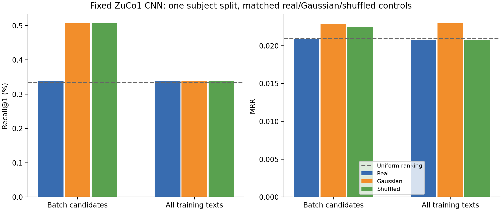

# Source-pairing audit and controlled CNN candidate comparison

Local follow-up, 2026-10-30. This study concerns **one within-ZuCo1 seed-42
subject split**. It preserves all earlier experiments and has a fresh matched
batch-loss baseline. Historical ZuCo1 CNN scores used a 3,356-observation cohort;
this comparison fixes the already-existing 3,349-observation duration-QC cohort
for both loss arms. It is not a re-labeling of the historical checkpoint.

## Available source evidence

The [original ZuCo data descriptor](https://www.nature.com/articles/sdata2018291)
describes 500 Hz acquisition, Cz recording reference, 105 retained scalp
channels, Automagic processing, and 0.5 Hz high-pass plus 49–51 Hz notch filtering.
Its average-reference fixation-related-potential validation is a separate
analysis. Those descriptions support acquisition context; they do not establish
the precise filtering/reference state of every local sentence export. The
[authors' NLP repository](https://github.com/DS3Lab/zuco-nlp) documents downstream
NLP experiments and does not verify the original sentence-clock segmentation.

The local `data/raw/zuco1/download_plan.json` contains official OSF download
URLs, sizes and SHA256 values. The audit rehashed the 12 sentence exports and
12 subject-specific recording headers. All 24 match that archived download plan
in size and hash. This is verification against the archived official-source plan,
not a fresh remote checksum query. Header sampling rates and ordered channels
match the saved subject schemas. Only one recording header per subject is
locally available, and their histories do not establish complete upstream
filter/reference details for all source runs.

The official OSF API was reachable through the local network during this
follow-up. Two small source files were downloaded into the new audit folder and
verified against the live API's declared SHA256 values:

| Official source | Size | SHA256 |
|---|---:|---|
| [firstLevel_NR.m](https://osf.io/download/gan9v/) | 47,382 bytes | `4624c63811a56bfc7214a3b5be5344d1855b9587f38904e1eb851dcc808fa6f2` |
| [relations_labels_task2.csv](https://osf.io/download/tu6yx/) | 46,399 bytes | `017b118da4821e572a2e782f8add1e4a6258afeddf8566d68cf829f3bbf46cb9` |

The MATLAB script documents sentence-start/end codes 10/11, control-sentence
start/end 12/13 and response code 15 (lines 2–4). It deletes five practice
sentences (lines 42–45), assigns onset/offset samples from those sentence markers
(lines 276–305), and sets rejected sentence stops to zero for ±90 µV thresholding
(lines 322–325). It copies `FullEEG.data(1:nChans,start:stop)` to `rawSentEEG`
(line 518), uses NaN for excluded segments (line 535), and assigns `content` and
`rawData` from the same sentence index (lines 609–614). Spectral bands are
separate derived fields; they do not replace the waveform used here. This
supports the field/trigger interpretation. It is not a proven exact build script
for every released export: its subject list excludes ZJS and it depends on
external recordings, task files and manual path settings. No upstream MATLAB
pipeline was rerun or assumed identical across versions.

Comparison with the independent 300-row official task-2 stimulus CSV found
2,948 exact/canonical text matches out of 3,356 prepared observations. The other
408 observations correspond to **37 sentence rows** with text variants: 26 rows
differ only under punctuation/spacing/accent folding, and 11 have other character
differences. Examples include an extra prefix in `nVera-Ellen`, `wrote` versus
`write`, surname spellings/transliterations, and extra digits before `Senator`.
Minimum character-sequence similarity for the 37 corresponding rows is 0.9796;
this is a text-comparison diagnostic, not an EEG/semantic accuracy metric.
These variants were not silently normalized or substituted into the cached text
targets. The manifest matches the MATLAB exports exactly; the separate official
CSV is not byte-identical to those exports. The CSV's `sentence_id` is a source
document label, not the zero-based row index used by the MAT export. Detailed
variants are in `official_stimulus_comparison.json` and `stimulus_variant_audit.json`.
There is no evidence here of a wholesale row-offset mismatch, but the displayed
text versus export-text differences remain a source-version limitation. Their
effect on retrieval has not been experimentally isolated.

## Executed source/cache checks

`scripts/audit_pairing.py` reads the original `sentenceData.rawData` and
`sentenceData.content` fields for all 12 ZuCo1 subjects. It checks exact text,
zero-based sentence IDs, preserved MATLAB one-based indices, source hashes,
ordered channel metadata and reconstruction of existing processed waveforms.
It writes only new audit files; no source data or prepared shard is rewritten.

- 3,600 original sentence slots, 244 explicit missing-EEG slots and 3,356 prepared
  observations. Missing slots retain their original IDs; later sentences are not
  compacted into new pairings.
- **3,356/3,356 texts/indices matched**, and **3,356/3,356 waveform arrays matched
  bit for bit** after float32 conversion and 500→200 Hz anti-alias resampling.
  Maximum reconstruction difference is zero. Canonical text for each sentence
  slot is consistent across subjects.
- The existing duration QC removes seven observations of at most 0.1 s, retaining
  3,349 observations. No additional exclusions or filtering were introduced.
- No identical retained waveform pairs were found. Cz is the only channel
  flagged flat, in all 3,349 observations. This is consistent with a retained
  acquisition-reference channel but does not independently establish reference
  provenance; the channel set remains unchanged in both arms.
- Retained duration quantiles (min/25%/median/75%/max):
  0.360 / 3.890 / 5.885 / 9.070 / 47.260 seconds. The existing 8-second center
  crop truncates 1,033 observations (30.85%). Full-recording median absolute
  peak is 32.42 µV, 95th percentile 56.25 µV and maximum 91.73 µV.
- Actual cached provenance records anti-alias resampling only, with no new
  bandpass or notch. The generic filter defaults in `local.yaml` do not run
  during training on these prepared shards. Training normalization is fitted
  to the full training recordings, then applied to cropped model inputs, as
  in the existing implementation.

Audit artifacts: `results/pairing_audit_20261030/audit.json`, per-subject
`progress.json`, and `source_evidence.json` with all 24 expected/observed source
hashes and official download URLs. The source audit uses the same tested,
bounded-memory MAT reader as ingestion. It can detect stale/mispaired caches,
index shifts and resampling differences, but is not an independent audit of that
reader or a reconstruction of original triggers, stimulus onset/offset clocks,
eye-tracking synchronization or physical calibration. The field name `rawData`
does not imply an unfiltered acquisition waveform. No local cache-construction
error was found; original source annotation correctness remains unresolved.

A bounded continuous-recording check adds corroboration for one source run.
`scripts/audit_source_clock.py` reads `oip_ZDM_NR3_EEG.mat` in small windows and
finds exact all-channel matches for 49 exported sentences (zero-based IDs
100–148). All start samples coincide exactly with stored event codes 10
(42 windows) or 12 (7 windows), and all end samples with codes 11 (42) or 13
(7), respectively. Source slot 100 matches samples 5,929–9,183 inclusive
(3,255 samples). The set name is `ZDM_NR3 pruned with ICA`; its reference field
is the generic `common`. These values document that run without establishing
the reference electrode or identical preprocessing across the cohort. The
matches corroborate recording-clock intervals, with marker meanings supported
by the official script above. They do not independently replay original
stimulus presentation logs or verify all source runs. Details are in
`results/pairing_audit_20261030/continuous_recording_sample.json`.

The available continuous run contains 50 sentence-start markers. Its one
unmatched first window has an absolute peak of 182.92 in the documented µV
units, exceeding the official extraction script's ±90 threshold. That is
consistent with upstream rejection, not proof of its exact missing-slot index.
No claim is made that all source blocks or their numbering were reconstructed.

The text-cache side was checked independently by re-encoding all 300 texts on
CPU with the existing local MiniLM revision
`1110a243fdf4706b3f48f1d95db1a4f5529b4d41`, with network access disabled. All
300 fresh vectors had their same-key cached vector as nearest neighbor. Minimum
same-key cosine was 0.999999881, with maximum absolute element difference
1.1723×10⁻⁷. The original cache SHA256 stayed
`f38649e2ee0278f8ec1c512786b4313f8ea09b9ef51810af892f7745fc2ab7b6`.
This supports correct key/vector correspondence at numerical precision; it is
not an EEG decoding result. The cache and experiment targets were not replaced.
The audit is recorded in `text_cache_audit.json`.

## Fixed comparison and validation-only selection

The experiment is registered before training in
`results/cnn_candidate_comparison_20261030/plan.json`. It consists of six fits:
two loss scopes × real/Gaussian/shuffled controls. Both arms use the same 105
ordered channels, 200 Hz prepared waveforms, center crop at 1,600 samples,
compact CNN/128-dimensional encoder/projection, seed-42 initialization,
batch size 2, accumulation 8, AdamW learning rate 0.001, weight decay 0.01,
gradient clipping 1, temperature 0.07, mixed precision policy, maximum 50 epochs
and patience 8. There is no SSL initialization or architecture change.

The initial full source/cache audit completed before training began. The
read-only OSF script/stimulus-table and continuous-recording corroboration
continued while fits ran. Those additional findings did not change the cohort,
cached texts, preprocessing, settings or validation-only selection rule.

The existing subject split is fixed:

| Split | Subjects | Observations |
|---|---|---:|
| Train | ZDM, ZDN, ZGW, ZJM, ZJN, ZKH, ZMG, ZPH | 2,245 |
| Validation | ZJS, ZKW | 512 |
| Test | ZAB, ZKB | 592 |

The training bank contains all 300 unique **training** sentence embeddings.
No validation/test-only text can enter it. These within-dataset splits share
stimulus texts; this is retrieval across held-out readers, not unseen-sentence
or unrestricted language generation. Text embeddings are the existing immutable
MiniLM cache. Training does not re-encode or fit text embeddings; the separate
read-only reconstruction audit above does not change the cached targets.

The original loss is `(batch EEG→text + batch text→EEG) / 2`, with duplicate
sentences treated as positives. The new arm replaces only the forward
EEG→text denominator with all unique training sentences. It keeps the reverse
multi-positive batch term and the 1/2 weights unchanged. Thus each EEG query
sees 300 text candidates instead of its two-example batch, while the reverse
direction still uses the current EEG batch. This is not an all-dataset symmetric
EEG memory bank. Training labels for the shuffled control use the existing
consistent sentence-class derangement.

To avoid selecting epochs on losses with different candidate counts, **both
arms use the identical original batch contrastive loss on held-out validation
subjects** for checkpoint selection and early stopping. Other settings are
inherited and fixed, with no test-guided search. Validation/test labels are true
for shuffled training; Gaussian inputs retain per-observation/channel amplitude
and duration, with the same deterministic draws across loss arms.

All six fits must finish before `selection_frozen.json` records chosen checkpoint
hashes. Only then does the runner evaluate each selected artifact once on the
same test queries and 300-candidate pool. It verifies equal split digests,
normalizers, initial model hashes, channels and candidate keys before evaluation.
Earlier historical inspection of this cohort still makes this an exploratory
development study, not a new untouched confirmatory test.

The rule for preferring a loss family for real EEG is also validation-only:
choose the smaller common validation CE. Once both real-EEG fits finished and
before any new test report existed, this selected **batch loss** (0.697376)
over all-training candidates (0.697674). This choice is saved in
`real_loss_validation_choice.json`, with zero test reports present. Both arms
remain in the registered test comparison as ablations; a higher test score in
the non-selected arm would not justify changing the validation-based choice.

## Software validation

The updated full suite passed **145 tests, with 2 optional skips and no
deselections** using `.venv/Scripts/python.exe -m pytest -q -rs`. The skips are
the existing official-weight integration and extraction tests in
`tests/test_storage_and_pretrained.py`, because `EEG_LABRAM_CACHE` is unset:
`optional official-weight integration; no network download during unit tests`
and `optional official-weight extraction on synthetic fixtures`. The two existing
short-signal matplotlib warnings remain. The 513 MiB MATLAB test is included.

New synthetic tests check the exact forward/reverse loss formula, gradients,
frozen text candidates, equality with the baseline when the bank equals a unique
batch, invalid banks, identical initial models and inputs, Gaussian/shuffled
evaluation behavior, objective-mismatched resume rejection, and exclusion of
validation/test-only texts while common validation remains usable.

During the real GPU run, PyTorch warned that `CUBLAS_WORKSPACE_CONFIG` was unset.
The existing `warn_only=True` deterministic setting therefore does not guarantee
bitwise CuBLAS reproducibility. The environment is held unchanged for all six
fits. Initial parameter hashes, minibatch schedules and NumPy control draws are
matched, but small GPU numerical variation remains a limitation. No mid-run
environment or optimization change is made in response to validation/test scores.

## Measured held-out results

| Loss scope | Input/labels | Selected epoch (zero-based) | Common validation loss | Recall@1 | Recall@5 | Recall@10 | MRR |
|---|---|---:|---:|---:|---:|---:|---:|
| batch | real | 0 | 0.697376 | 0.338% | 1.520% | 3.209% | 0.020890 |
| batch | gaussian | 2 | 0.693672 | 0.507% | 2.027% | 3.885% | 0.022861 |
| batch | shuffled | 1 | 0.694353 | 0.507% | 1.351% | 3.378% | 0.022480 |
| training_unique | real | 0 | 0.697674 | 0.338% | 1.689% | 3.041% | 0.020789 |
| training_unique | gaussian | 3 | 0.693546 | 0.338% | 2.027% | 3.885% | 0.022962 |
| training_unique | shuffled | 1 | 0.696586 | 0.338% | 1.351% | 3.209% | 0.020752 |

All six evaluations use the same 592 queries and 300 candidates. Uniform-ranking expectations are Recall@1 0.333%, Recall@5 1.667%, Recall@10 3.333% and MRR 0.020942. Recall values come directly from the evaluation fields, not an MRR conversion.

| Loss scope | Contrast | ΔRecall@1 (pp) | ΔRecall@5 (pp) | ΔRecall@10 (pp) | ΔMRR |
|---|---|---:|---:|---:|---:|
| batch | real_minus_gaussian | -0.169 | -0.507 | -0.676 | -0.001971 |
| batch | real_minus_shuffled | -0.169 | +0.169 | -0.169 | -0.001590 |
| training_unique | real_minus_gaussian | +0.000 | -0.338 | -0.845 | -0.002173 |
| training_unique | real_minus_shuffled | +0.000 | +0.338 | -0.169 | +0.000037 |

| Control reference | Change in real-minus-control Recall@1 (pp) | Recall@5 (pp) | Recall@10 (pp) | MRR |
|---|---:|---:|---:|---:|
| change_in_real_minus_gaussian | +0.169 | +0.169 | -0.169 | -0.000202 |
| change_in_real_minus_shuffled | +0.169 | +0.169 | +0.000 | +0.001627 |

The change-in-gap rows subtract the batch-arm real-minus-control gap from the all-training-arm gap. They are descriptive comparisons within this one split, not confidence intervals or independent replications. Per-subject gaps for ZAB and ZKB, full-precision tables, archived audits, configs, split manifests and checksums are in `docs/research_results/cnn_candidates_20261030/`. Baseline/new best and last checkpoints remain under the fresh run root. No training accuracy is treated as evidence of success.

## Interpretation and remaining limitations

**This controlled comparison does not show a reliable real-EEG gain from expanding
the forward candidate bank.** Real Recall@1 stays at 2/592 hits. Recall@5 changes
from 9 to 10 hits, Recall@10 from 19 to 18 hits, and MRR falls by 0.000101.
Gaussian MRR is higher in both arms: the real-minus-Gaussian gap worsens from
−0.001971 to −0.002173, a change of −0.000202. The small positive change in the
Recall@1 control gap comes from Gaussian/shuffled hit counts falling from three
to two, not from any extra real-EEG hit.

The all-training real MRR is only 0.0000369 above its shuffled control. That
isolated positive gap accompanies a decline in real MRR and a larger decline in
shuffled MRR; it does not demonstrate improved decoding. The real-minus-Gaussian
MRR gap in the new arm is −0.005597 for ZAB and +0.001227 for ZKB, so the apparent
advantage is not consistent across the two held-out readers either. Training
loss declines and memorization results do not alter this interpretation.

The validation-based preference remains the batch-loss real-EEG model. The test
comparison does not justify promoting the all-training alternative. This is one
seed, one previously inspected cohort/split, two test subjects, fixed inherited
temperature/optimizer and a common **batch-loss validation criterion**. It tests
one all-training-forward formulation with the reverse batch term retained; it
does not rule out every global-candidate objective or validation strategy.
Source-text variants, partial upstream timing/reference evidence, truncated
recordings and the CuBLAS reproducibility warning remain limitations. No
statistical significance, independent replication, unseen-content transfer,
general text generation or general absence of semantic EEG information is claimed.

The final artifact checks verify identical initial model hashes, parameter shapes,
normalizers, source splits and input configs apart from the declared loss scope;
all selected epochs minimize the full recorded validation histories. All six
test reports were written after checkpoint selection was frozen. A direct
synthetic CPU comparison with the original Git baseline confirms the default
batch loss and its gradients are unchanged. The 67 previously checksummed
experiment files remain byte-identical. See
`docs/research_results/cnn_candidates_20261030/validation.json`.
