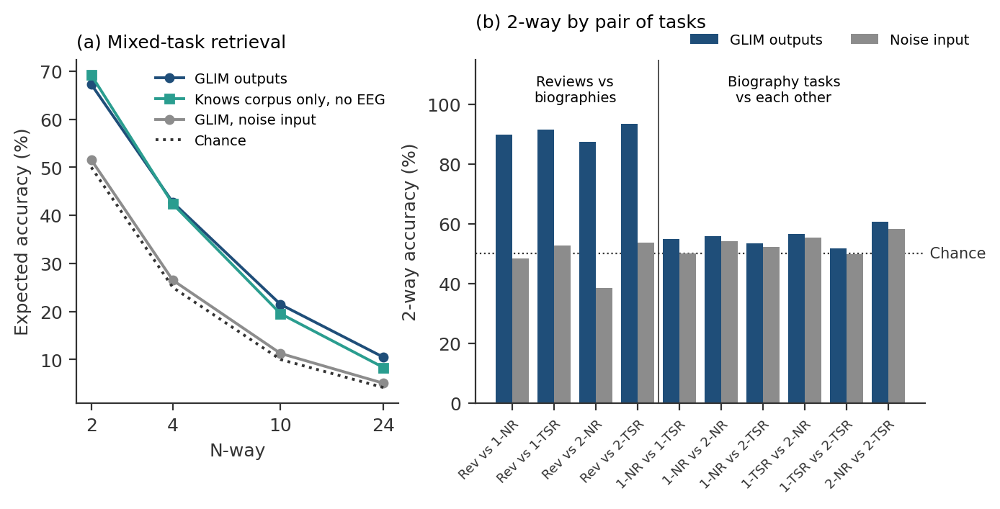
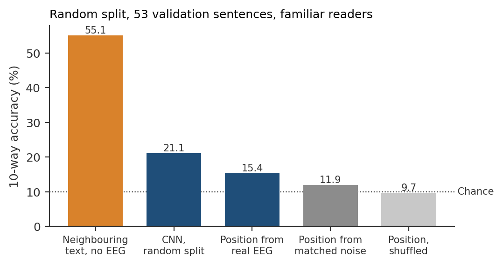
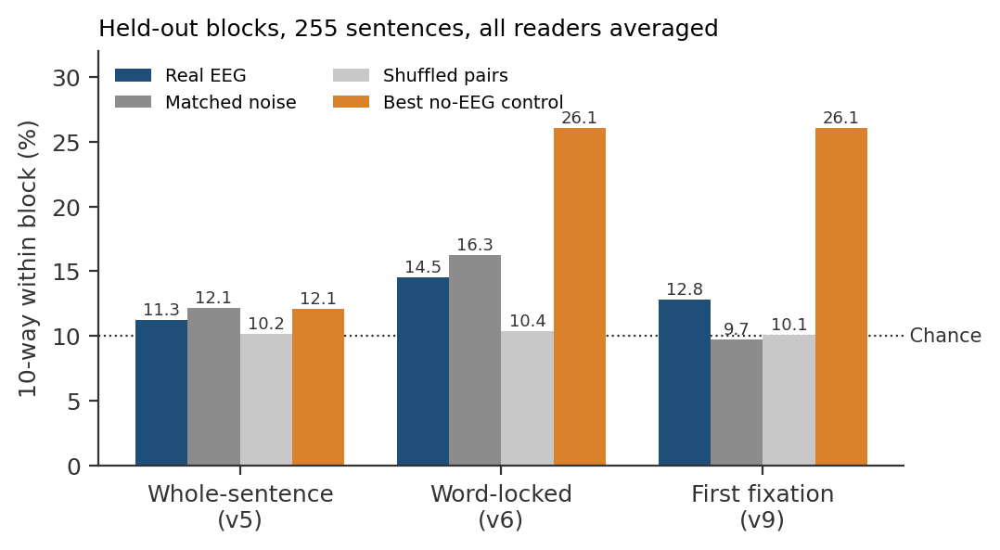
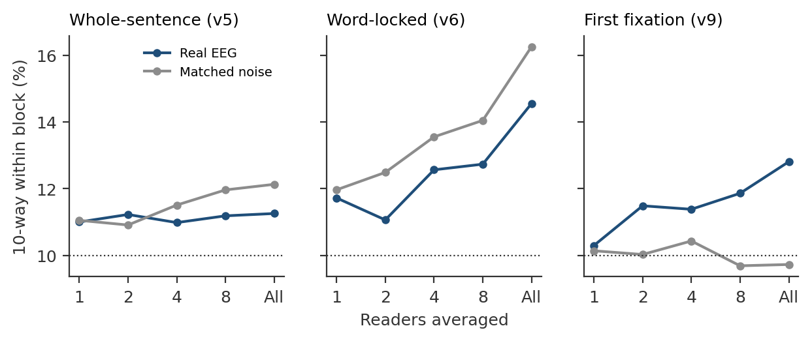

# What ZuCo EEG-to-text retrieval scores measure: an audit of task mixing, list position and controls

**Draft 2, 14 November 2026.** Ziad Mohamed. Every number comes from a report in `docs/research_results/`, and each section links its source. Figures are made by `scripts/paper/make_figures.py` from saved results only. Items marked **TODO** need work before submission.

## Abstract

EEG-to-text models trained on the ZuCo reading corpora are often scored by N-way sentence retrieval. We audit what this score measures. On GLIM's public test outputs, the mixed-task 10-way score of 21.46% (chance 10%) falls to 9.73–14.25% within any single task. A predictor that knows only whether a sentence is a movie review or a biography, with no EEG, scores 19.53%. Random sentence splits are also weak: readers saw sentences in one fixed order, so the text of a held-out sentence's list neighbours, with no EEG, scores 51.09% at 10-way, and EEG predicts list position (correlation 0.80–0.88). Under frozen tests that hold out whole list blocks, EEG never beat matched noise, whether as whole-sentence, word-locked or first-fixation features. Gaze and word properties with no EEG scored 26.05%. Once gaze was known, EEG added 0.10 points, and the data allow at most 2.37. Two more published models retrieve no better than chance and noise. We do not claim that ZuCo EEG lacks language information, only that these scores do not show it. We propose five reporting controls that would.

## 1. Introduction

Decoding language from non-invasive brain recordings would matter for communication aids and for the science of reading. ZuCo 1.0 and 2.0 (Hollenstein et al. 2018, 2020) are the standard public datasets of EEG recorded during natural reading, with eye tracking that marks each fixated word. A line of work trains models from ZuCo EEG to text and scores them with generation metrics or with N-way sentence retrieval.

Problems with this line of work are known. Models trained with teacher forcing produce similar text from noise input (Jo et al. 2024). Zhang et al. (2026) report that ZuCo scores match noise baselines, and Yin et al. (2025) show that common cross-subject splits leak test data into training. We extend this critique to the retrieval scores that newer models report, and ask three questions:

1. **Task mixing:** when test sentences come from different reading tasks and corpora, how much of an N-way score comes from telling the corpora apart?
2. **Split design:** do random sentence splits let list position or recording drift stand in for content?
3. **Controls:** under a split that removes these routes, does EEG beat matched noise and a gaze-only predictor, and how large a gain do the data still allow?

Our contributions:

- A breakdown of a published model's own public outputs by task and by distractor type, and an exact ceiling for a predictor that knows only the corpus (Section 4).
- A no-EEG neighbouring-text baseline showing how easy random ZuCo splits are, and evidence that EEG encodes list position (Section 5).
- Frozen tests on held-out list blocks with buffers, with matched noise, shuffled pairs, list position, timing and gaze controls, for whole-sentence, word-locked and first-fixation EEG, and the largest effect each test still allows (Section 6).
- Five reporting controls for EEG-to-text retrieval (Section 7).

Each idea has partial precedent (Section 2 and Table 1). We believe the combination, run on one data set under frozen plans, is new.

## 2. Related work

**ZuCo and its benchmark.** ZuCo 1.0 has 12 readers and ZuCo 2.0 has 18 different readers; Hollenstein et al. (2021) state that the two datasets used different participants. Both present sentences in a fixed order, identical for all readers. Hollenstein et al. (2021) also showed that EEG can classify ZuCo 2.0 recording blocks, with errors mostly in neighbouring blocks, and the ZuCo benchmark (Hollenstein et al. 2023) shuffled its test sentences to stop models identifying a block.

**EEG-to-text on ZuCo.** Wang and Ji (2022) decoded open-vocabulary text with BART from word-level EEG features. Jo et al. (2024) showed that such models produce similar text from noise input. GLIM (Liu et al. 2025) and SemKey (Wang et al. 2026) report N-way retrieval; SemKey's paper reports GLIM at 21.91% for 10-way.

**Critiques and leakage.** Zhang et al. (2026) report that ZuCo decoding scores match noise and attribute this to EEG instability, but do not test list position. Yin et al. (2025) show leakage in cross-subject brain-to-text splits. Li et al. (2020) showed that block designs let EEG classifiers exploit temporal correlation rather than stimulus content, and later work examines temporal autocorrelation in EEG decoding more generally (**TODO:** cite arXiv 2405.17024 after reading it).

**Positive results.** McGuire and Moshfeghi (2025) report above-noise passage retrieval at P@5 (12.39 against 4.13) on a different task and split, and Marquardt et al. (2026) report a strict positive on their own single-reader recordings. Raghavan and Parra (2025) find that fixation-locked ZuCo EEG tracks word features.

**Unreviewed public code.** Three public repositories overlap with our claims, and we found no paper from them. We cite them as prior work.

**Table 1.** What each closest source covers. "Yes" means shown on ZuCo; "partly" means shown in a narrower form.

| Source | Task mixing in a model's outputs | Neighbouring-text or position baseline | Block holdout with buffers, matched noise | Gaze-only baseline for retrieval | Frozen plans |
|---|---|---|---|---|---|
| Zhang et al. 2026 | No | No | Partly (noise, no blocks) | No | No |
| Hollenstein et al. 2021, 2023 | No | Partly (block classification) | No | Partly (task classification) | No |
| bleepbloop301/eeg2text-reproductions | Yes (corpus recovered from GLIM's outputs 97% of the time) | Yes (position controls) | No | No | No |
| RahmaDawy/eeg-language-decoding | No | No | Partly (sentence level, no buffers) | Partly (not word-locked) | No |
| thestonedape/task-aware-eeg2text | Partly (task margin, model not named) | No | No | No | No |
| **This work** | Yes, with per-task and per-pair scores and a corpus-only ceiling | Yes | Yes, three EEG representations | Yes, word-locked | Yes |

Our search method and counts are in `docs/literature_search_20261106/`. It was not exhaustive: keyword rules removed records before reading, and Google Scholar was not searched.

## 3. Data and scoring

**Data.** We use the normal-reading tasks of ZuCo 1.0 and 2.0, with the supplied preprocessed EEG (105 channels; Cz removed in the block tests) and word-level features: 30 readers in total. Sentences from an earlier test set and a reserved test zone were never fitted or scored in any analysis here (Section 8).

**Expected N-way accuracy.** For a query sentence, we compute the exact expected top-1 accuracy over all ways of drawing N−1 distractors from a pool, with ties counted as misses. Chance is 1/N. Unless stated otherwise, scores are 10-way with one equal-weight score per sentence, and text targets are all-MiniLM-L6-v2 sentence embeddings.

**Pools.** *Mixed* pools draw distractors from all tasks, *within-task* pools from the query's own task, and *within-block* pools (Section 6) from the query's own held-out list block, which makes coarse list position much less useful.

**Matched noise.** Our main null replaces the EEG with Gaussian noise that keeps each recording's per-channel amplitude. For word-locked features it also keeps each recording's mean word vector and fixation pattern, and replaces only word-specific EEG, at the reader's within-recording spread. This null keeps slow drift and amplitude differences between sentences, so it often sits above chance. That is intended: it is the bar for content beyond those. Noise was passed through the same fitting and scoring as real EEG.

**Decision rule.** In frozen tests, a comparison is *clear* only if the gap is at least 2 points and every available 95% lower bound is above 0. Bounds come from resampling sentences, blocks and, where defined, readers.

## 4. Task mixing in published outputs

### 4.1 GLIM's score comes from telling corpora apart

We scored GLIM's three public output files (repository commit `e1f202c`) with no EEG read: 1,889 rows and 156 sentences after protected sentences were removed. [Source](research_results/glim_output_check_20261106/REPORT.md).

| Predictor | 2-way | 4-way | 10-way | 24-way |
|---|---:|---:|---:|---:|
| Chance | 50.00 | 25.00 | 10.00 | 4.17 |
| GLIM, as reported in the SemKey paper | 66.83 | 42.45 | 21.91 | 10.74 |
| GLIM outputs, our scoring | 67.26 | 42.71 | 21.46 | 10.47 |
| GLIM with noise input | 51.55 | 26.50 | 11.26 | 5.06 |
| Knows corpus only, no EEG (exact) | 69.19 | 42.36 | 19.53 | 8.33 |
| Knows task only, no EEG (exact) | 89.23 | 72.23 | 43.16 | 20.48 |

Our scoring reproduces the published numbers closely. The last two rows are exact expectations for a predictor that ranks every sentence from the query's own corpus (or task) above all others and is at chance within it, given this test set's composition (40 movie-review and 116 biography sentences in five tasks). [Source](research_results/paper_analyses_20261114/label_ceiling.json). **Knowing only the corpus matches GLIM at 2-way and 4-way and comes within 2 points at 10-way and 24-way** (Figure 1a).

**Figure 1.** (a) GLIM's public outputs against a corpus-only predictor with no EEG. (b) 2-way accuracy for each pair of tasks. Rev = movie reviews; NR = normal reading; TSR = task-specific reading; 1 and 2 = ZuCo release.

Within a single task, GLIM's 10-way score is 9.73% to 14.25% (Table 2). At 2-way it separates movie reviews from any biography task 87.36–93.57% of the time, but biography tasks from each other only 51.89–60.66% (Figure 1b). Same-task pairs score 51.75% (95% interval 50.27 to 53.30).

**Table 2.** 10-way within each pool, one row per sentence per trial.

| Pool | Sentences | GLIM | Noise input |
|---|---:|---:|---:|
| All tasks | 156 | 21.71 | 11.10 |
| ZuCo 1.0 movie reviews | 40 | 10.53 | 9.44 |
| ZuCo 1.0 normal reading | 15 | 14.13 | 11.50 |
| ZuCo 1.0 task-specific reading | 39 | 9.73 | 12.31 |
| ZuCo 2.0 normal reading | 24 | 14.25 | 11.58 |
| ZuCo 2.0 task-specific reading | 38 | 11.30 | 10.06 |

### 4.2 What drives the corpus gap

The gap is not the task prompt alone: two ZuCo 1.0 tasks share the same prompts in GLIM's code, yet that pair scores 89.94%. Real EEG is needed, as noise input scores 48.53% on the same pair. Movie reviews were read only in their own recording sessions, so the EEG could reflect content or recording session. These outputs cannot separate the two.

### 4.3 Two further models

Wang and Ji's BART model and Jo et al.'s T5 variant have public test outputs (79 usable sentences). At 10-way across movie reviews and biographies, BART scored 10.01% (noise input 10.09%), and its outputs contain only 4 distinct texts. T5 scored 12.38% (noise 9.61%), a gap over chance of 2.38 points (interval −0.65 to 5.63). A predictor that knows only the corpus scored 13.35%. Neither model retrieves its sentence above chance and noise. These models report no mixed-task score, so they do not repeat the GLIM pattern. [Source](research_results/public_outputs_check_v8_20261112/REPORT.md).

## 5. Random splits and list position

ZuCo readers saw sentences in one fixed order, and EEG drifts over a session. On a random sentence split, a held-out sentence's list neighbours are usually in training.

**Neighbouring-text baseline.** With no EEG, predicting a held-out sentence as the text of training sentences at its true list position scores 51.09% at 10-way, averaged over 20 random 10% splits (range 38.36 to 65.62), and 43.73% at 25% holdout. [Source](research_results/position_bridge_v4_20261105/REPORT.md).

**EEG encodes list position.** For readers seen in training, a ridge model from EEG to list position predicted held-out sentences' positions with correlations of 0.80 (ZuCo 1.0) and 0.88 (ZuCo 2.0). Matched noise still reached 0.54 and 0.69. Copying the text of training sentences at the predicted position scored 15.41% at 10-way, against 9.70% with shuffled positions (gap 5.72, reader interval 3.29 to 8.23; Figure 2). Position is coarse here, off by 21 to 37 sentences, so this route reaches about half of the CNN's gain above chance. It shows the route exists, not how much the CNN used it.

**Figure 2.** 10-way accuracy on 53 validation sentences of a random split, for readers seen in training. "Position from real EEG" maps EEG to list position and copies the text of training sentences there.

**The split changes the score.** The same CNN architecture scored 23.10% at 10-way on validation under a random split, and 10.02% under a block split with buffers (matched noise 9.72%). That drop also reflects fewer training sentences and different preprocessing, so it does not measure the leak alone. [Source](research_results/block_holdout_pilot_v2_20261105/REPORT.md).

## 6. Frozen tests on held-out blocks

### 6.1 Design

Each of 13 list blocks (5 in ZuCo 1.0, 8 in ZuCo 2.0) is held out once. Training leaves out that block and 10 list positions on each side. This scores 255 sentences. Models are ridge regressions from EEG to text embeddings, with the penalty chosen inside each fold's training data. Each test had a written plan, and a configuration file whose SHA-256 was recorded in the run script before running. Each also had synthetic tests showing that position-only and duration-only signals could not pass, a leakage audit that refused to run on any failure, and a stop rule.

| Control | What it rules out |
|---|---|
| Matched noise | Channel amplitudes and slow drift (Section 3) |
| Shuffled pairs | Pipeline artefacts; breaks the EEG–sentence pairing |
| List position, no EEG | Place in the list, even inside a block |
| Timing and word count, no EEG | Sentence length and reading time |
| Gaze and word properties, no EEG | Word length, frequency, reading time, fixations and word position |
| Partial check | Removes position, its square, word count and reading time from real and noise predictions inside each block |

### 6.2 Results

**Table 3.** Expected 10-way within the query's own held-out block, 255 sentences, all readers averaged. Chance 10%. Word-locked rows use centred scoring, so they are not on exactly the same scale as the whole-sentence row.

| Test | Real EEG | Matched noise | Shuffled pairs | Strongest no-EEG control | Real minus noise (sentence 95%) |
|---|---:|---:|---:|---:|---|
| Whole-sentence, reader-averaged (v5) | 11.25 | 12.13 | 10.18 | Timing 12.07 | −0.88 (−3.01 to 1.19) |
| Word-locked band features (v6) | 14.55 | 16.25 | 10.37 | Gaze 26.05 | −1.70 (−6.43 to 2.81) |
| First-fixation waveform (v9) | 12.81 | 9.72 | 10.11 | Gaze 26.05 | 3.08 (−1.50 to 7.79) |

Sources: [v5](research_results/averaged_eeg_v5_20261106/REPORT.md), [v6](research_results/word_locked_v6_20261106/REPORT.md), [v9](research_results/first_fixation_v9_20261114/REPORT.md).

**Figure 3.** Held-out block tests. The best no-EEG control is timing for v5 and gaze with word properties for v6 and v9.

- **No test was clear against noise.** Real EEG beat shuffled pairs clearly only for word-locked features (4.18 points), which shows the pipeline finds structure, but noise matched it.
- **Gaze is the strongest arm.** Gaze and word properties with no EEG beat word-locked EEG by 11.51 points (interval −16.60 to −6.34). Adding the first-fixation waveform to gaze gave 24.39%, against 24.29% for adding noise.
- **The first-fixation gap is early.** It sits 50–200 ms after fixation onset, when the early visual response appears, and fits a response to word length or appearance that gaze already captures. Removing 21 anterior channels nearest the eyes left a 4.54-point gap, not clear across readers, with noise falling to 7.35%.
- **Structure explains the word-locked gain.** Removing position, word count, reading time and fixated-word count took word-locked real EEG to 10.02%.

### 6.3 How large an effect is still possible

A null result is only as useful as its interval. Table 4 gives, for each test, the upper ends of the 95% intervals: the largest gain over the null that these data do not rule out. [Source](research_results/paper_analyses_20261114/effect_limits.json).

**Table 4.** Points at 10-way; intervals from resampling sentences and blocks.

| Test | Comparison | Gap | Sentence 95% | Block 95% | Largest gain allowed |
|---|---|---:|---|---|---:|
| Whole-sentence (v5) | Real minus noise | −0.88 | −3.01 to 1.19 | −3.32 to 0.95 | 1.19 |
| Whole-sentence (v5) | Partial check | −2.48 | −6.67 to 1.68 | −6.63 to 1.70 | 1.70 |
| Word-locked (v6) | Real minus noise | −1.70 | −6.43 to 2.81 | −5.83 to 2.22 | 2.81 |
| Word-locked (v6) | Partial check | −1.96 | −5.81 to 1.73 | −5.95 to 1.99 | 1.99 |
| First fixation (v9) | Real minus noise | 3.08 | −1.50 to 7.79 | −1.91 to 9.29 | 9.29 |
| First fixation (v9) | Partial check | 2.34 | −2.47 to 7.22 | −2.85 to 8.43 | 8.43 |
| First fixation (v9) | Gaze plus real minus gaze plus noise | 0.10 | −1.56 to 1.72 | −1.82 to 2.37 | 2.37 |
| Same sentence (v7) | Real minus noise | 1.50 | −4.98 to 8.20 | | 8.20 |

Whole-sentence and word-locked EEG add at most about 1 to 3 points over noise at 10-way. The first-fixation waveform alone leaves room for up to about 9 points, but once gaze is known it adds at most 2.37. So any EEG contribution that gaze does not already carry is small under this design, and a study powered to find it would need many more sentences.

### 6.4 Readers and new readers

A shared signal should grow as more readers are averaged, and faster than noise. It did not (Figure 4). At one reader, real and noise were 11.00 and 11.05 (v5), 11.72 and 11.96 (v6), and 10.29 and 10.13 (v9). Fitting on 15 readers and averaging the other 15 on the same blocks gave 9.67% for whole-sentence features (noise 11.23%) and 13.22% for word-locked features (noise 13.31%).

**Figure 4.** 10-way within block against the number of readers averaged.

### 6.5 The same sentence across releases

Forty-eight sentences were read in both releases by different readers. With nothing fitted, a sentence's averaged EEG found its own copy in the other release 28.18% of the time at 10-way, against 26.68% for matched noise (gap 1.50, interval −4.98 to 8.20). List position alone scored 54.39% and word count with reading time 52.74%, because the shared sentences sit in similar positions in both lists (correlation 0.70). With these removed, real scored 18.40% and noise 16.06%. [Source](research_results/same_sentence_v7_20261106/REPORT.md).

## 7. Discussion

**What the scores measure.** On GLIM's outputs, the mixed-task score mostly measures corpus separation, and a corpus-only predictor with no EEG nearly matches it. On random splits, list neighbours and EEG-predicted position can supply much of a retrieval score without sentence content. Under block holdout, every EEG representation we tried fell to the level of matched noise, gaze with no EEG beat all of them, and EEG added at most 2.37 points to gaze.

**Five reporting controls for EEG-to-text retrieval.**

1. Report N-way scores within each task, and a corpus-only or task-only ceiling for the test set's composition.
2. Hold out whole list blocks with buffers, not random sentences, and report a neighbouring-text baseline for any random split.
3. Use matched noise that keeps per-recording amplitude, not only chance or unmatched Gaussian noise, as the bar.
4. Report a gaze and word-property baseline with no EEG, and the gain of EEG over it.
5. Report scores against the number of readers averaged, down to one, and the largest effect the intervals allow.

**What this does not show.** It does not show that ZuCo EEG lacks language information. Our models were linear, on summary features, and Raghavan and Parra (2025) find word features in fixation-locked ZuCo EEG, which fits our early visual gap. A larger or nonlinear model might find more, but it would face the same controls.

## 8. Limitations

- **Reused data.** The 255 block-holdout sentences were all used in earlier development, and the first-fixation lead was found on them, so these results are exploratory. Reserved test blocks exist and have not been scored. **TODO:** owner's decision on scoring them once, under a new frozen plan.
- **Small samples.** 255 sentences in 13 blocks, 48 shared sentences and 79–156 output sentences give wide intervals (Table 4).
- **One model shows the mixed-task pattern.** SemKey's outputs are not public, so the strongest published model is untested. The corpus-only ceiling applies to any model scored on the same test composition, but whether SemKey exceeds it is unknown.
- **Content or session.** The corpus gap in GLIM's outputs could reflect content or recording session. The same-sentence test covers biography sentences only and does not settle this.
- **Noise definition.** Our matched noise is a strong null that sits above chance. A different null could give different gaps.
- **Inherited preprocessing.** We used the supplied preprocessed EEG and could not refit upstream filtering or referencing.

## 9. Reproducibility and ethics

Code, frozen plans, configuration hashes, leakage audits and numeric results are in the public repository (**TODO:** add the URL and a release tag). No raw EEG or ZuCo text is redistributed; readers must obtain ZuCo from its official source. **TODO:** confirm the ZuCo licence terms for derived files and for quoting sentences.

## References

Checked against the publisher, arXiv or OpenAlex record on 14 November 2026 unless marked.

- Hollenstein, N., Rotsztejn, J., Troendle, M., Pedroni, A., Zhang, C. and Langer, N. (2018). ZuCo, a simultaneous EEG and eye-tracking resource for natural sentence reading. *Scientific Data* 5, 180291. doi:10.1038/sdata.2018.291
- Hollenstein, N., Troendle, M., Zhang, C. and Langer, N. (2020). ZuCo 2.0: A dataset of physiological recordings during natural reading and annotation. *LREC 2020*, 138–146.
- Hollenstein, N., Tröndle, M., Plomecka, M., Kiegeland, S., Özyurt, Y., Jäger, L. A. and Langer, N. (2021). Reading task classification using EEG and eye-tracking data. arXiv:2112.06310.
- Hollenstein, N. et al. (2023). The ZuCo benchmark on cross-subject reading task classification with EEG and eye-tracking data. *Frontiers in Psychology* 13. doi:10.3389/fpsyg.2022.1028824 (**TODO:** full author list)
- Jo, H., Yang, Y., Han, J., Duan, Y., Xiong, H. and Lee, W. H. (2024). Are EEG-to-text models working? arXiv:2405.06459.
- Li, R. et al. (2020). The perils and pitfalls of block design for EEG classification experiments. *IEEE TPAMI*. doi:10.1109/tpami.2020.2973153 (**TODO:** full author list)
- Liu, X., Shen, D. and Liu, X. (2025). Learning interpretable representations leads to semantically faithful EEG-to-text generation. arXiv:2505.17099. (GLIM; outputs from github.com/justin-xzliu/GLIM, commit e1f202c.)
- Marquardt, I., Alchanat, A. and Jain, P. (2026). Decoding silent reading from non-invasive EEG. arXiv:2608.20186.
- McGuire, N. and Moshfeghi, Y. (2025). Towards brain passage retrieval: an investigation of EEG query representations. *SIGIR 2025*. doi:10.1145/3726302.3730097
- Raghavan, V. S. and Parra, L. C. (2025). Neural encoding of linguistic features during natural sentence reading. *iScience* 28(7), 112798. doi:10.1016/j.isci.2025.112798
- Wang, Y., Wang, H., Guo, Y., Yang, H. and Li, X. (2026). Escaping the BLEU trap: a signal-grounded framework with decoupled semantic guidance for EEG-to-text decoding. arXiv:2603.03312. (SemKey.)
- Wang, Z. and Ji, H. (2022). Open vocabulary electroencephalography-to-text decoding and zero-shot sentiment classification. *AAAI 2022*. doi:10.1609/aaai.v36i5.20472
- Yin, C., Yu, Q., Fang, Z., Peng, C. and Li, P. (2025). Rethinking cross-subject data splitting for brain-to-text decoding. *EMNLP 2025*. doi:10.18653/v1/2025.emnlp-main.289
- Zhang, Z., Bao, Y., Ding, X., Jiang, T. and Xiong, K. (2026). Is EEG-to-text feasible in real-world scenarios? An in-depth analysis using a neuropsychology-inspired benchmark. *ACL 2026*, 1378–1393.
- Public repositories, accessed 6 November 2026: bleepbloop301/eeg2text-reproductions, RahmaDawy/eeg-language-decoding, thestonedape/task-aware-eeg2text.

## Open decisions before submission

1. Venue and length.
2. Whether to score the reserved test blocks once as confirmation.
3. Whether to contact the authors of the overlapping repositories.
