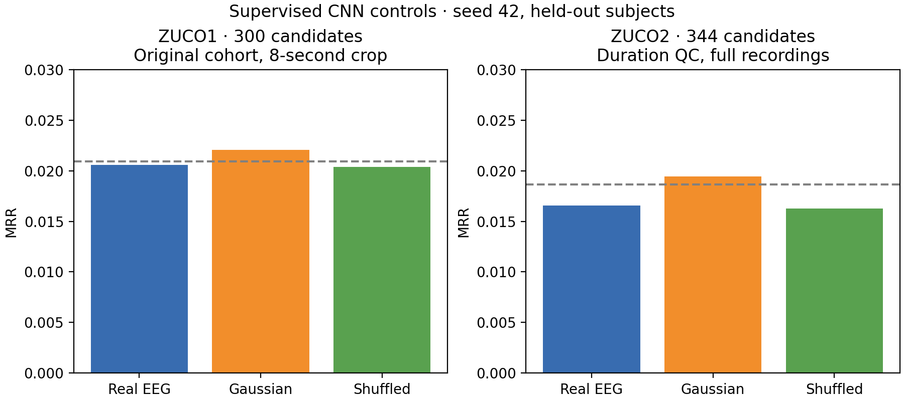
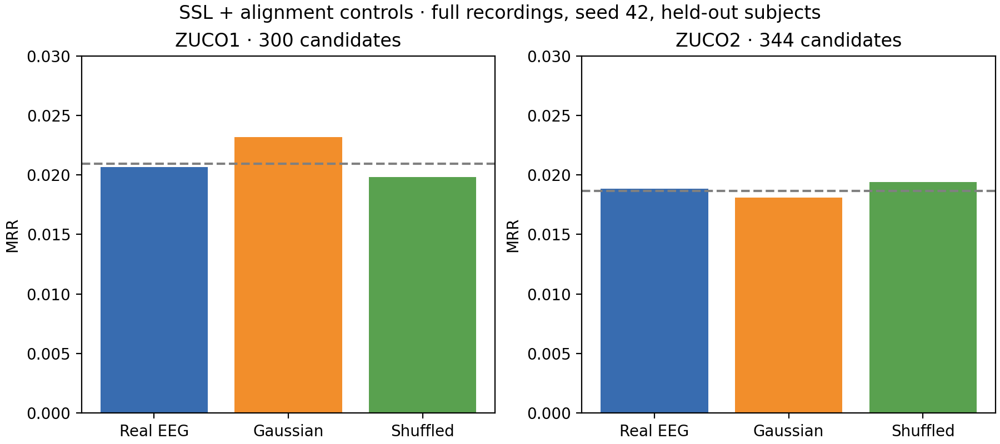
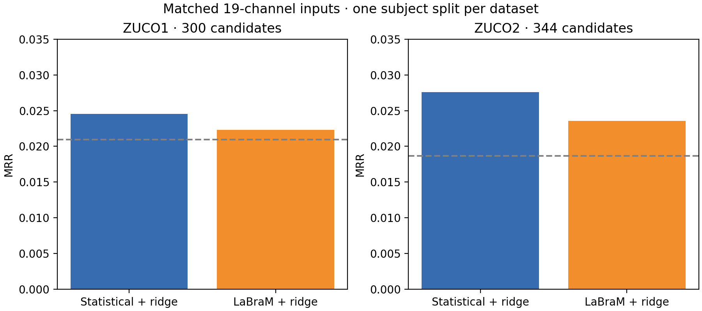
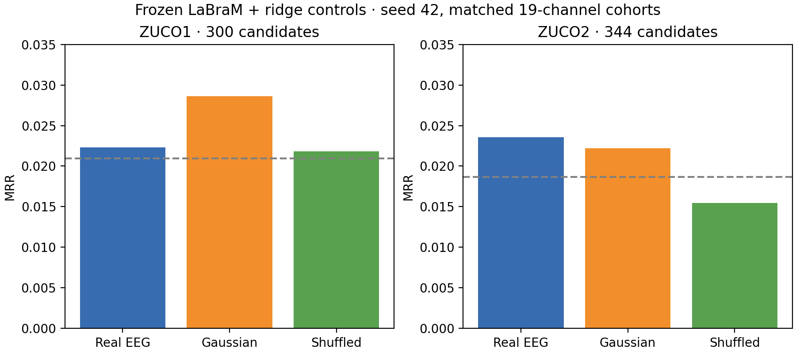
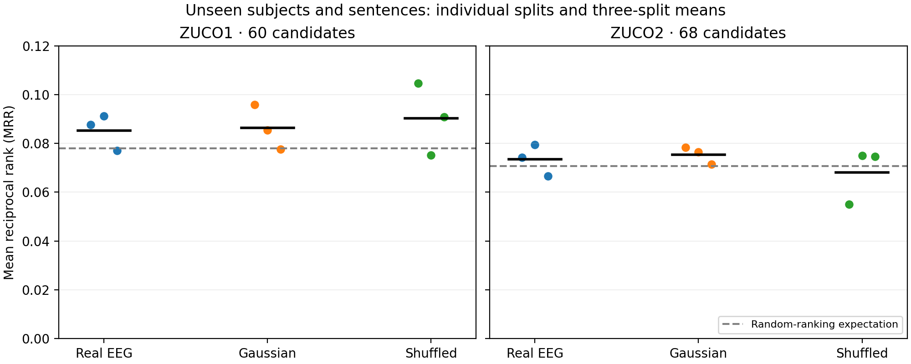
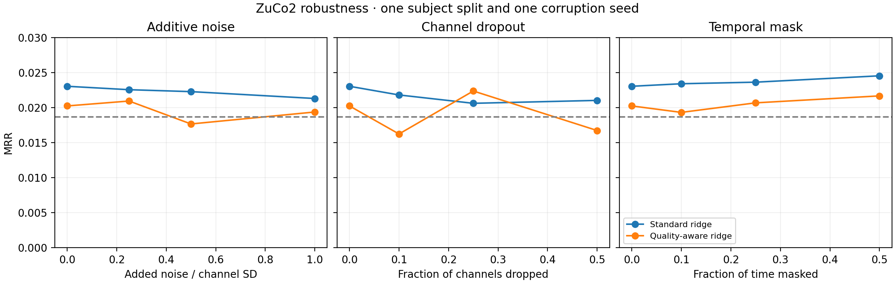

# EEG representation learning: results and completion review

Draft research report, 2026-10-29. Measurements come from the user's Windows
RTX 3050 execution, archived in [retrieval.csv](retrieval.csv). This is a
descriptive analysis of executed experiments, not a claim of independent cloud
reproduction or a completed research campaign.

## Main finding

The tested statistical, supervised CNN, masked-reconstruction SSL and frozen
LaBraM representations do not establish reliable sentence retrieval across
subjects or unseen sentence content. Real EEG does not consistently outperform
matched Gaussian controls. Some results exceed uniform random-ranking
expectations, but that alone is insufficient evidence of useful EEG decoding.

These negative findings are scientifically reportable. They do not establish
that EEG contains no semantic information or that pretrained EEG models cannot
work. Results concern these implementations, adaptations, cohorts and splits.

## Data and methods

ZuCo1 preparation produced 3,356 observations from 12 subjects; ZuCo2 produced
5,911 from 18. Original missing EEG slots were audited. Duration QC excluded
7 ZuCo1 and 27 ZuCo2 segments of at most 0.1 seconds, leaving 3,349 and 5,884.
An inspected YTL source slot contained a single sample and was excluded during
technical preparation with an audit entry. The selected condition is normal
reading (`nr`), with 105 ordered channels resampled to 200 Hz. Existing source
preprocessing was retained; anti-alias resampling was applied. Complete original
trigger timing and per-run reference/filter histories have not been verified.

Models predict cached MiniLM sentence embeddings. Evaluation ranks a fixed,
explicit pool of unique sentences with cosine similarity. This is retrieval,
not unrestricted text generation. Data-dependent normalization and feature
scaling use training observations. Model selection uses validation subjects;
test inspection across development makes the overall history exploratory.

Statistical features combine per-channel statistics and spectral band powers.
Ridge uses float64 scaling and SVD fitting. The CNN learns compact waveform
representations. SSL first reconstructs masked temporal blocks, then initializes
sentence alignment. Gaussian controls match each observation's channel standard
deviations and therefore preserve amplitude information; they are not equivalent
to uniformly random rankings. Shuffled controls use separately trained models
with deranged sentence labels and true evaluation labels.

Earlier ZuCo1 inputs were center-cropped to at most 8 seconds. Later filtered
experiments use complete recordings. These are separate conditions, not a
controlled cropping-only ablation. Repeated neural alignment runs had declining
training loss and worsening validation loss; early stopping selected epoch 0.

## Supervised CNN negative controls

The updated export adds four CNN control evaluations to the original 63 reports.
The original rows and measurements are unchanged. Comparisons below match the
existing real-EEG supervised CNN in each dataset, not the SSL-initialized model.

| Dataset | Training condition | Recall@1 | Recall@5 | Recall@10 | MRR |
|---|---|---:|---:|---:|---:|
| ZuCo1 | Real EEG | 0.338% | 1.858% | 3.209% | 0.020596 |
| ZuCo1 | Gaussian inputs | 0.338% | 1.858% | 3.885% | 0.022081 |
| ZuCo1 | Shuffled pairs | 0.169% | 1.689% | 3.716% | 0.020392 |
| ZuCo2 | Real EEG | 0.305% | 0.813% | 2.541% | 0.016582 |
| ZuCo2 | Gaussian inputs | 0.305% | 1.524% | 3.252% | 0.019452 |
| ZuCo2 | Shuffled pairs | 0.203% | 0.915% | 2.134% | 0.016242 |

ZuCo1 uses the original 3,356-observation cohort, an 8-second center crop,
microbatch size 2, 592 queries and 300 candidates. ZuCo2 uses the filtered
5,884-observation cohort, full recordings, microbatch size 8, 984 queries and
344 candidates. Both use seed 42. These two data recipes are not a controlled
cross-dataset performance comparison. The summarizer checks equal candidate
pool hashes and matching protocol, seed and query counts
within each dataset; full preprocessing/configuration matching also relies on
the recorded execution commands because these fields are absent from the CSV.

Real and Gaussian CNNs have equal top-1 hit counts (2 in ZuCo1, 3 in ZuCo2),
and Gaussian MRR is higher in both. The results do not demonstrate a real-EEG
advantage for these supervised CNN configurations. No statistical significance
is claimed from one split. SSL and adapted pretrained ridge controls are
reported separately below; these CNN results must not be relabeled as those
controls.



The source filenames and full metrics are in
[cnn_controls_summary.csv](cnn_controls_summary.csv).

## Full-sentence SSL negative controls

These comparisons use the duration-filtered 105-channel cohorts (3,349 ZuCo1
and 5,884 ZuCo2 observations), full recordings, seed 42 and alignment microbatch
size 8. They match each full-sentence real-EEG SSL/alignment configuration,
not the earlier cropped ZuCo1 experiment.

| Dataset | Condition | Recall@1 | MRR |
|---|---|---:|---:|
| ZuCo1 | Real EEG | 0.169% | 0.020680 |
| ZuCo1 | Gaussian inputs | 0.338% | 0.023159 |
| ZuCo1 | Shuffled pairs | 0.338% | 0.019842 |
| ZuCo2 | Real EEG | 0.305% | 0.018846 |
| ZuCo2 | Gaussian inputs | 0.305% | 0.018117 |
| ZuCo2 | Shuffled pairs | 0.305% | 0.019402 |

ZuCo1 has 592 queries/300 candidates; ZuCo2 has 984/344. Gaussian MRR exceeds
real EEG on ZuCo1; shuffled MRR exceeds real EEG on ZuCo2. Real top-1 hits are
1 versus 2 for each control in ZuCo1 and 3 for all three conditions in ZuCo2.
These outcomes do not establish a consistent real-EEG advantage. Differences
are descriptive; no statistical significance claim is made.

Gaussian SSL was pretrained from scratch on Gaussian waveforms from training
observations, then used to initialize Gaussian-input sentence alignment. Thus
the Gaussian condition covers both learned stages, rather than corrupting only
the input after real-data pretraining. Shuffled-pair alignment reused the real
SSL encoder because that pretraining objective uses no sentence labels.
Normalization uses only training observations; validation selects checkpoints.

Recorded Gaussian SSL folders end in `20261029_060922`. Best pretraining epochs
were 15 (ZuCo1, validation reconstruction loss 0.444607) and 4 (ZuCo2, 2.002514).
Shuffled alignment initialized from real SSL checkpoints in
`zuco1_ssl_full_sentence_20261027_170627` and
`zuco2_ssl_full_20261028_211015`. Alignment control evaluations end in
`20261029_142036`. Pretraining details come from the user's execution transcript;
the CSV itself does not contain upstream checkpoint identities. Original
checkpoints and configurations should be retained for the final audit.



Full metrics and source filenames are in
[ssl_controls_summary.csv](ssl_controls_summary.csv).

## Matched pretrained comparison

Stored coordinates from 30 recording headers match a HydroCel template.
The documented approximate mapping selects 19 real electrodes for standard
positional tokens, with angular errors of 2.11–9.40 degrees and a Cz anchor.
Both comparison methods use identical adapted signals, complete seconds and
subject splits. Inputs under one second are excluded, leaving 3,345 ZuCo1 and
5,838 ZuCo2 observations. Official frozen LaBraM weights are checksum-verified.
Mapping, upstream filtering and reference uncertainties limit paper-reproduction
claims; this is an exploratory adaptation.

| Dataset | Features + ridge | Recall@1 | Recall@5 | Recall@10 | MRR |
|---|---|---:|---:|---:|---:|
| ZuCo1 | Statistical | 0.507% | 1.689% | 3.716% | 0.024530 |
| ZuCo1 | LaBraM | 0.169% | 2.196% | 4.392% | 0.022326 |
| ZuCo2 | Statistical | 0.814% | 2.442% | 4.374% | 0.027599 |
| ZuCo2 | LaBraM | 0.407% | 2.238% | 3.967% | 0.023559 |

ZuCo1 has 592 queries/300 candidates; ZuCo2 has 983/344. Uniform chance MRR is
0.020942 and 0.018661, respectively. LaBraM has lower top-1 and MRR in both
datasets; ZuCo1 Recall@5/10 is higher. This is one split, without significance
claims. Matched adapted-cohort negative controls are reported next.



## Frozen LaBraM ridge negative controls

These use the same 19-channel prepared observations, whole-second temporal
support, seed 42, subject split and candidate pool as each real-EEG LaBraM ridge.
The completed real feature caches were verified and reused; Gaussian waveforms
were passed through the same frozen official backbone. Separate Gaussian and
shuffled-pair ridge models were then fit with source-training normalization and
validation selection. These are not controls for a fine-tuned LaBraM model or
for the ZuCo SSL encoder.

| Dataset | Condition | Recall@1 | MRR |
|---|---|---:|---:|
| ZuCo1 | Real EEG | 0.169% | 0.022326 |
| ZuCo1 | Gaussian inputs | 0.676% | 0.028627 |
| ZuCo1 | Shuffled pairs | 0.338% | 0.021823 |
| ZuCo2 | Real EEG | 0.407% | 0.023559 |
| ZuCo2 | Gaussian inputs | 0.509% | 0.022214 |
| ZuCo2 | Shuffled pairs | 0.102% | 0.015474 |

ZuCo1 has 592 queries and 300 candidates; ZuCo2 has 983 queries and 344
candidates. Gaussian features outperform real EEG on ZuCo1. On ZuCo2 real EEG
has slightly higher MRR but fewer top-1 hits (4 versus 5). These outcomes do not
show a consistent real-EEG advantage under this adaptation. No significance
claim is made from this single split.



The export contains two timestamped report sets for each control, `054736` and
`060032` on 2026-10-29. All exported fields other than filenames are identical
within each pair. Each condition is displayed once; no scores are averaged or
selected for better performance. Both source filenames remain in
[labram_controls_summary.csv](labram_controls_summary.csv), and all original
rows are retained. Equality of exported values does not prove identical
checkpoint bytes or independent replication. The summarizer rejects differing
repeated-condition values pending explicit review.

## Unseen subjects and unseen sentence content

Means below give each seed (42, 43, 44) equal weight. SD is sample SD across
splits, not a confidence interval. Splits reuse participants and stimuli and
cannot be treated as independent participant cohorts.

| Dataset | Condition | Mean Recall@1 | Mean MRR ± split SD |
|---|---|---:|---:|
| ZuCo1 | Real EEG | 2.335% | 0.085268 ± 0.007368 |
| ZuCo1 | Gaussian | 2.335% | 0.086335 ± 0.009157 |
| ZuCo1 | Shuffled | 2.895% | 0.090252 ± 0.014689 |
| ZuCo2 | Real EEG | 1.337% | 0.073448 ± 0.006412 |
| ZuCo2 | Gaussian | 1.691% | 0.075441 ± 0.003512 |
| ZuCo2 | Shuffled | 1.348% | 0.068180 ± 0.011447 |

ZuCo1 uses 60 candidates (chance MRR 0.077998) and 117/111/115 queries by seed.
ZuCo2 uses 68 candidates (chance MRR 0.070648) and 197/203/193 queries. These
percentages cannot be directly compared with 300/344-candidate retrieval. Real
EEG exceeds Gaussian MRR only on seed 43 in each dataset.



## Robustness and quality weighting

The ZuCo2 full-sentence ridge comparison uses one subject split, 984 queries,
344 candidates and one corruption seed. Clean MRR is 0.023036 for standard
ridge versus 0.020230 for the quality-aware variant. Quality-aware MRR is lower
in 8 of 9 nonzero corruption conditions; the exception is 25% channel dropout.
No consistent benefit is demonstrated for the implemented weighting heuristic.

Corruption curves are non-monotonic near chance. Temporal masking sometimes
increases retrieval scores, which does not establish that removing signal is
beneficial. Low baseline performance, small hit counts, and random corruption
variation limit robustness conclusions. Each corruption has different severity
units, so separate panels are used.



## Comparison with published work

A source-verified [literature and protocol comparison](../published_work_comparison.md)
reviews the official AAAI 2022 EEG-to-text implementation, its acknowledged
evaluation correction and the official LaBraM task/input requirements. Primary
sources are pinned and hashed in [literature_sources.json](literature_sources.json).

Published generation BLEU/ROUGE scores and LaBraM classification results cannot
be ranked against our fixed-pool sentence Recall@K/MRR. Word-level spectral EEG,
all-subject sentence-index partitions, language decoders, montage adaptation and
different candidate pools further limit comparability. This review establishes
methodological context, not a reproduced numerical benchmark or competitive
decoding claim. Its correction discussion is attributed to the original
repository notice and the correction maintainers' documentation.

## Completion checklist

| Requirement | Evidence/status |
|---|---|
| Modular local/Colab implementation and tests | Implemented; latest full suite 115 passed; real Colab execution not established |
| Both datasets, lazy preparation, metadata and duration QC | Executed; original timing/reference audit remains limited |
| Statistical and supervised CNN baselines | Executed on both versions |
| ZuCo-trained SSL and semantic alignment | Executed on both versions; reconstruction improvement did not establish decoding |
| Official pretrained EEG comparison | Executed with documented approximate 19-channel adaptation |
| Noise and shuffled controls | Executed for statistical ridge, supervised CNN, full-sentence SSL/alignment and adapted LaBraM ridge on both versions; conclusions limited to these tested configurations |
| Quality-aware and corruption evaluation | Executed for ZuCo2 ridge; conclusions limited to that comparison |
| Unseen-subject evaluation | Executed; broader neural split variability remains unexecuted |
| Unseen-subject and unseen-content evaluation | Ridge/control comparison executed for three seeds on each version |
| ZuCo1 → ZuCo2 and reverse transfer | **Unexecuted: participant independence/correspondence unresolved** |
| Published-work discussion | Primary-source protocol comparison completed; protocol-matched numerical reproduction remains unexecuted |
| Figures and consolidated analysis | Initial figures and descriptive report generated here |
| Final submission/presentation | Pending remaining requirements and review; this is a draft |

The supplied ZuCo2 paper confirms 18 released participants and repeated
stimuli, but does not explicitly establish cohort independence from ZuCo1.
Different labels alone are insufficient. No invented participant identities or
strict-audit bypass is used. Local NR manifests have 50 shared canonical texts;
transfer must disclose overlap and distinguish unseen-content transfer.

## Reproducibility and limits of the export

All 79 rows are preserved: the original 63, four added CNN controls, eight
LaBraM control reports (two timestamped reports per dataset/control condition),
and four full-sentence SSL controls.
Eight groups have identical exported values,
listed in [export_audit.json](export_audit.json); this does not prove checkpoint
identity. Corruption conditions, zero-severity evaluations, reruns and the
superseded numerically unstable ridge fit are not independent methods or
replications. The CSV lacks original artifact/config/split identities, candidate
counts, per-subject statistics and confidence intervals. Method-specific cohort
and candidate counts above also use the previously supplied execution logs.
Archive the original JSON files, split manifests and checkpoints before final
submission. Do not infer participant-cluster intervals from aggregate CSV rows.

Rebuild generated tables and figures from the repository root:

```bash
python scripts/summarize_research.py
```

The script validates required metric ranges, exactly three seeds per unseen-
content condition and unique corruption severity points. Outputs include PNG/SVG
figures, [unseen_content_summary.csv](unseen_content_summary.csv), and
[cnn_controls_summary.csv](cnn_controls_summary.csv), and
[labram_controls_summary.csv](labram_controls_summary.csv), and
[ssl_controls_summary.csv](ssl_controls_summary.csv). The CNN, SSL and LaBraM
summaries also check within-dataset protocol, seed, candidate hash, query count
and control labels. Repeated LaBraM reports are summarized once only if every
exported field except filenames agrees.
